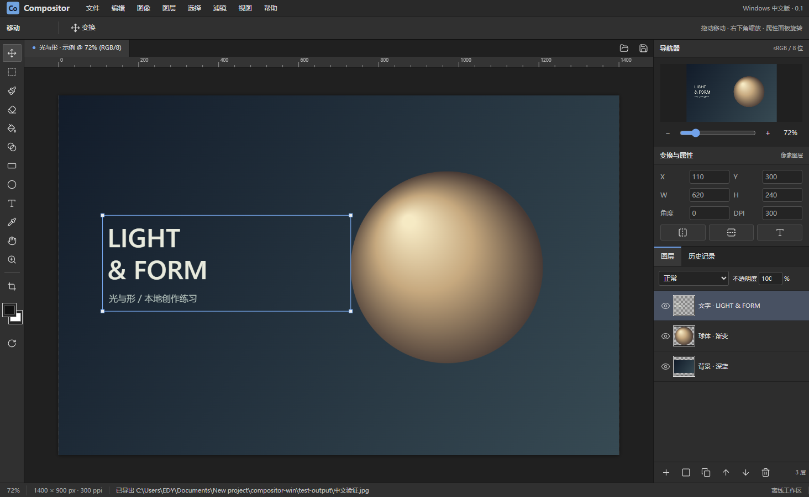

# Compositor中文版

可直接运行的 Windows x64 桌面图像编辑器，当前版本 **0.1.0**。

## 下载

前往 [GitHub Releases](https://github.com/Lujincheng-lang/Compositor-ZH/releases/latest) 下载：

- **安装版**：`Compositor-ZH-0.1.0-Setup.exe`，支持中文安装向导、安装目录选择、桌面和开始菜单快捷方式。
- **便携版**：`Compositor-Windows-zh-0.1.0-portable.zip`，解压整个文件夹后运行 `Compositor 中文版.exe`。
- **源码包**：`Compositor-Windows-zh-0.1.0-source.zip`，或直接克隆本仓库。
- **示例项目**：`Compositor-ZH-0.1.0-Demo.cwin`，从软件的文件菜单打开。



## 启动

安装版运行安装向导后，从桌面或开始菜单启动。便携版解压后双击 `Compositor 中文版.exe`，需要保持整个文件夹完整，不能只移动 EXE。使用软件不需要安装 Node.js，不需要账号。

## 当前已实现

- 中文深灰工作区：菜单、工具选项、左侧工具栏、导航器、变换属性、图层和历史记录。
- 新建与打开 PNG/JPEG/WebP/BMP，拖入或置入图片。
- 图层新增、复制、删除、重命名、上下移动、可见性、锁定、不透明度，16 种 Canvas 混合模式。
- 画笔与橡皮擦：大小、硬度、工具不透明度；每笔独立记录撤销。
- 矩形选区、全选、取消选择、选区约束绘画与滤镜、选区复制、填充和清除。
- 连续区域油漆桶、前景到背景渐变、栅格矩形与椭圆、吸管。
- 中文多行文字、字体名称、字号、颜色、粗体和再次编辑。绘画或滤镜会栅格化文字，可撤销。
- 图层移动，右下角缩放，精确位置、尺寸、旋转角度，水平与垂直翻转。
- 栅格蒙版：画笔隐藏，橡皮擦恢复；蒙版通过独立透明度保存，原像素保留。
- 亮度、对比度、饱和度、去色、反相、高斯模糊，支持矩形选区。
- 修改画布大小与 DPI、按选区裁切、向下合并。
- 原生 `.cwin` 项目保存重开，保留图层原像素、文字参数、蒙版和变换。
- PNG 透明导出、JPEG 白底导出，写入 DPI；栅格图层 PSD 导入与导出。
- 导入原版 Compositor `.comp` 文件夹中的基础栅格图层和链接灰度蒙版。
- 最多 30 条、约 96 MB 快照历史；每 60 秒自动备份当前修改，可从文件菜单恢复。关闭有修改文档时询问保存。

## 快捷键

| 操作 | 快捷键 |
| --- | --- |
| 新建 / 打开 / 保存项目 | Ctrl+N / Ctrl+O / Ctrl+S |
| 撤销 / 重做 | Ctrl+Z / Ctrl+Shift+Z 或 Ctrl+Y |
| 新图层 / 复制选区或图层 | Ctrl+Shift+N / Ctrl+J |
| 移动 / 矩形选区 / 画笔 / 橡皮 | V / M / B / E |
| 填充 / 渐变 | G / Shift+G |
| 矩形 / 椭圆 / 文字 / 吸管 | U / Shift+U / T / I |
| 全选 / 取消选区 | Ctrl+A / Ctrl+D |
| 精确变换 / 向下合并 | Ctrl+T / Ctrl+E |
| 平移 / 缩放 | 空格拖动 / 滚轮 |
| 微移 / 大步微移 | 方向键 / Shift+方向键 |
| 适合屏幕 / 100% | Ctrl+0 / Ctrl+1 |
| 前景背景交换 / 画笔大小 | X / [ 和 ] |
| 前景色填充 / 清除选区像素 | Alt+Backspace / Delete |
| 画布专注模式 | F，Esc 返回 |

## 格式与限制

这是基于 Compositor 工作流和公开文件格式开发的 Windows 独立实现；**不是把 Swift/Metal 源码直接编译到了 Windows，也不是 Photoshop 的完整替代品**。

- 目前单文档工作区，RGB/sRGB、8 位。没有 ICC 软打样、CMYK、16/32 位、专色和印刷级色彩管理。
- 单画布边长最大 8192 px，总像素不超过 16,777,216；最多 100 图层，图层源像素总量不超过 8000 万。大图层、导出和历史快照仍会消耗明显内存，尚无 4K/8K 性能基准。
- `.cwin` 为中文版本独立 ZIP 项目格式，不可改名为 `.comp`。原版 `.comp` 当前只读导入；本软件不修改原文件。
- `.comp` 版本 1–11，仅支持普通像素图层、相应变换、已支持混合模式和启用的链接栅格蒙版。组、文字元数据、形状元数据、效果、调整图层、剪贴蒙版、分离或禁用蒙版明确拒绝导入。原版参考线目前不导入。
- PSD 仅接受普通 **RGB 8 位栅格图层**。组、文字、调整层、蒙版、剪贴、效果等高级结构明确拒绝；请在 PS 转成普通栅格图层或导出 PNG。
- 导出 PSD 保留栅格图层名称、顺序、可见性、不透明度和已支持混合模式；文字、变换、蒙版烘焙到各层像素。请同时保存 `.cwin`。已在本程序回读，**尚未在 Photoshop 实机验证**。
- 形状是栅格层；亮度等调整是可撤销的像素操作。裁切会烘焙文字、变换和蒙版。向下合并仅支持两个未锁定、可见、正常混合模式图层。
- 自动备份只有最近一份，不代替手动保存或完整版本备份。历史与选区不写入项目。
- 安装包和便携包未使用商业代码签名，Windows 可能显示未知发布者提示。

## 源码开发

使用 Node.js 24 或兼容版本：

```powershell
npm.cmd ci
npm.cmd run build
npm.cmd start
npm.cmd test
npm.cmd run dist:win
npm.cmd run dist:installer
```

`npm.cmd run dev` 提供开发浏览器界面；系统文件选择与自动恢复需要 Electron 桌面版。

- `src/engine.js`：文档、图层、蒙版、历史、格式、滤镜。
- `src/app.js`：中文界面、画布交互、菜单、对话框、快捷键。
- `src/style.css`：统一工作区样式和设计变量。
- `electron/main.cjs`、`preload.cjs`：隔离桌面外壳、系统文件对话框、原子保存、自动备份。
- `tests/smoke.cjs`：启动实际 Electron 窗口验证交互、像素、文件与格式。
- `docs/ROADMAP.md`：继续逼近 PS 的实施顺序。
- `docs/VALIDATION.md`：已验证的范围及未验证项目。

## 来源和授权

原项目：<https://github.com/robbietilton/Compositor>。研究快照 commit：`af30c45c10b1cddc2b9fe8401c137f250d50abb6`，2026-10-09 获取。原版使用 SwiftUI、AppKit、Metal，要求 Apple silicon Mac 与 macOS 26。

本版本参照原版工作流、公开 README 与 `.comp` 文件格式，重新实现跨平台编辑核心。保留 `LICENSE-Compositor.txt` 的原版 MIT 声明。未复制 Adobe 商标、图标或程序资源。第三方依赖许可一并保留在发行包依赖和 Electron 许可文件中。
